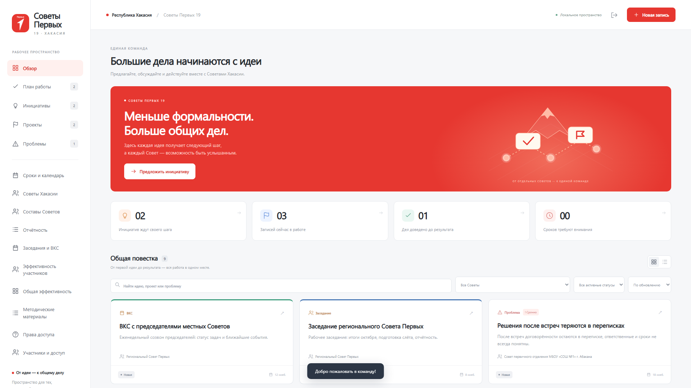

<div align="center">
  

  <h1>Советы Первых 19 · Хакасия</h1>

  <p><strong>От идеи — к общему делу.</strong></p>

  <p>
    Единое цифровое пространство для Советов Первых Хакасии:<br>
    инициативы, проекты, планы, люди, заседания и результаты — в одном месте.
  </p>

  <p>
    <a href="https://sovetpervih19.ru">
      
    </a>
    <a href="https://github.com/Roman821/zhivye-sovety/actions/workflows/tests.yml">
      
    </a>
    
    <a href="LICENSE">
      
    </a>
  </p>

  <p>
    <a href="#возможности">Возможности</a> ·
    <a href="#быстрый-старт">Быстрый старт</a> ·
    <a href="#права-доступа">Права доступа</a> ·
    <a href="#разработка">Разработка</a> ·
    <a href="#документация">Документация</a>
  </p>
</div>

---

## О проекте

**«Советы Первых 19»** — рабочая платформа, которая помогает превращать предложения участников в конкретные дела и видеть их результат. Она объединяет региональные, местные и первичные Советы, сохраняя понятную структуру доступа для каждого уровня.

Платформа опубликована по адресу **[sovetpervih19.ru](https://sovetpervih19.ru)**. До входа доступен ознакомительный режим с демонстрационными данными; они не попадают в рабочую базу.



## Возможности

| Раздел | Что умеет платформа |
|:---|:---|
| **Повестка и план работы** | Задачи, инициативы, проекты и проблемы; подзадачи, ответственные, сроки, приоритеты и статусы; обсуждения и история изменений. |
| **Сроки и календарь** | Общий и личный календари, плановые заседания и ВКС, прогресс по подзадачам, выделение просрочек. |
| **Личный кабинет** | Просмотр и редактирование своих данных, личная статистика, управление портфолио, смена электронной почты и пароля с подтверждением текущим паролем. |
| **Советы и участники** | Общий реестр Советов, составы и профили участников, несколько должностей и членство в нескольких Советах, поиск с подсказками. Просмотр и скачивание портфолио, скачивание фотографии из профиля. |
| **Вопрос/ответ** | Временная рубрика для тестирования: участники задают вопросы о платформе, координатор и специалист отвечают; вопросы и ответы видны всей команде. |
| **Отчётность** | Запросы годовых отчётов, черновики и отправка, карточки мероприятий, яркие практики, сводные итоги, корзина и восстановление. |
| **Заседания и ВКС** | Планирование встреч, итоги, решения и следующие шаги, поимённая посещаемость, связь с инициативами и проектами. |
| **Эффективность** | Личные и общие показатели, месячные графики, рейтинг и итоги по Советам — на основе фактических записей платформы. |
| **Документы и методические материалы** | Конструктор семи видов документов с проверкой полей и кворума, скачивание DOCX, библиотека файлов и ссылок с гибким доступом. |
| **Выгрузки** | Excel для составов, отчётности, заседаний и эффективности; CSV для итогов отчётности. |
| **Советник** | Опциональный помощник на GigaChat: отвечает по данным платформы с учётом прав пользователя и подсказывает, как выполнить действие. |
| **Работа на разных устройствах** | Адаптивный интерфейс и PWA: платформу можно установить на компьютер или телефон как приложение. |

> **Без лишних зависимостей.** Основные функции работают на Node.js без установки npm-пакетов и без сторонних сервисов. Для работы «Советника» требуется отдельное подключение GigaChat; без него помощник отключён.

## Быстрый старт

### Требования

- **Node.js 24 или новее**.
- npm-пакеты устанавливать не нужно.

### Запуск на Windows

Дважды нажмите **`start.cmd`** — сервер запустится, а сайт откроется автоматически.

Повторный запуск открывает уже работающий сайт. Адрес локальной версии:

**http://127.0.0.1:18765**

### Запуск из терминала

```bash
git clone https://github.com/Roman821/zhivye-sovety.git
cd zhivye-sovety
npm start
```

Для разработки с остановкой через `Ctrl+C`:

```bash
npm run dev
```

### Первый вход

1. Нажмите **«Войти»**.
2. Создайте рабочее пространство: укажите имя, почту и пароль длиной не менее 10 символов.
3. Первый созданный аккаунт становится **координатором**.

Почта используется как логин — письма для регистрации не отправляются. При размещении на сервере для создания первого аккаунта дополнительно потребуется `SETUP_CODE`.

## Приглашение и регистрация

Координатор и участники с соответствующим правом могут приглашать команду через **«Участники и доступ» → «Пригласить участника»**.

- Код приглашения действует **7 дней** и только **один раз**.
- Совет и должности задаются приглашением, а не формой регистрации.
- Если указано ФИО, участник сразу появляется в составе Совета.
- Возможна самостоятельная регистрация с выбором существующего Совета и должностью «участник»; управленческие роли через публичную форму не выдаются.
- Совпадения ФИО и повторные карточки обрабатываются через подтверждение управляющего, без автоматического объединения разных людей.

## Права доступа

Доступ зависит от уровня Совета, должностей, назначенных записей и отдельных разрешений. При совмещении должностей действуют наиболее широкие права.

| Роль или уровень | Область доступа |
|:---|:---|
| **Координатор, специалист** | Все Советы, управление участниками, приглашения, отчёты, статистика и выгрузки. Аккаунт координатора защищён от отключения и изменения роли. |
| **Региональный Совет** | Просмотр всех Советов, изменение записей своего Совета. |
| **Муниципальный куратор** | Местный Совет своего района и подчинённые первичные Советы. |
| **Местный Совет** | Просмотр своего и подчинённых первичных Советов, изменение записей своего Совета. |
| **Первичный Совет** | Работа только со своим Советом. |
| **Ответственный участник** | Доступ к назначенным ему записям независимо от общих ограничений. |

Управляющий может выдать отдельные права: приглашать участников, запрашивать или просматривать отчёты, вести план, составы и заседания, добавлять методические материалы. Полная актуальная матрица доступна внутри платформы в разделе **«Права доступа»**.

## Данные и безопасность

- **База данных:** SQLite, по умолчанию `data/sovety.sqlite`; создаётся автоматически.
- **Пароли:** хеширование scrypt с солью.
- **Сессии:** HttpOnly cookies; при внешнем HTTPS-запуске — с флагом Secure. После смены пароля завершаются сеансы на других устройствах, текущее устройство остаётся в аккаунте.
- **Смена доступа:** в личном кабинете можно изменить электронную почту и пароль; оба действия требуют текущий пароль.
- **Одновременное редактирование:** версии записей защищают от незаметной перезаписи чужих изменений.
- **Фотографии, портфолио и контакты:** выдаются только авторизованным пользователям с соответствующим доступом. Портфолио принимаются в PDF, Word, PowerPoint, JPG, PNG или ZIP размером до 50 МБ.
- **Завершение и архив:** для завершения записи требуется фактический результат; архивирование и корзина сохраняют историю.

> **Важно:** не добавляйте папку `data` в репозиторий и не передавайте её вместе с исходниками. В ней находятся рабочие сведения, учётные записи и файлы участников.

### Резервные копии

Для полной локальной копии остановите приложение и скопируйте всю папку `data`. Для восстановления верните сохранённую папку на место при остановленном приложении.

Выгрузка JSON в разделе **«Как это работает»** содержит записи и историю, но не является полным архивом учётных записей. Автоматического восстановления из JSON через интерфейс нет.

На основном сервере настроены ежедневные локальные копии базы. Они не заменяют отдельную внешнюю копию. Скачать согласованную копию рабочей базы на компьютер:

```bash
bash scripts/backup.sh
```

Файл сохраняется в `backups/`, которая исключена из git.

## Разработка

### Проверка проекта

```bash
npm test
```

Тесты используют отдельную временную базу и не изменяют рабочие данные. Они проверяют регистрацию, роли и приглашения, записи и комментарии, фильтры, отчётность, документы, PWA, доступы, миграции и другие ключевые сценарии.

Те же тесты автоматически запускаются в **GitHub Actions** при каждом push и pull request.

### Структура

```text
zhivye-sovety/
├── public/                 # Интерфейс, стили, PWA и клиентские модули
├── tests/                  # Автоматические тесты
├── scripts/                # Развёртывание и резервное копирование
├── deploy/                 # Конфигурация веб-сервера
├── docs/readme/            # Материалы для README
├── server.mjs              # HTTP API, SQLite и основная логика
├── *-features.mjs          # Отдельные серверные модули платформы
├── launch.mjs, start.cmd   # Локальный запуск
├── HOSTING.md              # Размещение и эксплуатация сервера
└── ROADMAP.md              # Этапы развития проекта
```

### Технологии

- **Backend:** Node.js, встроенные HTTP API и SQLite.
- **Frontend:** HTML, CSS и JavaScript без сборки.
- **Экспорт:** локально поставляемые ExcelJS 4.4.0 и docx 9.5.1, обе под лицензией MIT.
- **Инфраструктура:** Docker, Caddy, HTTPS, GitHub Actions.

## Развёртывание

Основной адрес платформы: **https://sovetpervih19.ru**.

Дополнительный адрес: **советпервых19.рф** — переадресует на основной домен.

Для обновления основного сервера:

```bash
bash scripts/deploy.sh
```

Скрипт последовательно:

1. проверяет чистое состояние git;
2. запускает тесты;
3. отправляет код на GitHub;
4. создаёт копию базы на сервере;
5. заменяет код и перезапускает сайт;
6. проверяет ответ и при сбое возвращает предыдущую версию.

Для работы скрипта нужен настроенный SSH-доступ под именем `sovety`.

<details>
<summary><strong>Основные переменные окружения</strong></summary>

| Переменная | Назначение |
|:---|:---|
| `HOST`, `PORT` | Адрес и порт HTTP-сервера. |
| `PUBLIC_ORIGIN` | Точный публичный HTTPS-адрес без пути. |
| `SETUP_CODE` | Случайный секрет от 32 символов для создания первого аккаунта. |
| `SOVETY_DATA_DIR` | Постоянная папка рабочей базы и файлов. |
| `GIGACHAT_AUTH_KEY` | Опциональное подключение «Советника»; без ключа помощник отключён. |
| `SOVETY_NOTIFICATIONS` | `on` включает встроенные и push-уведомления; по умолчанию они отключены. |

Внешний запуск без корректного `PUBLIC_ORIGIN` и достаточно длинного `SETUP_CODE` отклоняется. Секреты нельзя добавлять в репозиторий.

</details>

Подробности о доменах, Caddy, службе, дисках и копировании — в [HOSTING.md](HOSTING.md).

## Ограничения текущей версии

- Нет почтового восстановления пароля; для сброса требуется обслуживание базы. Не удаляйте базу при утере пароля.
- JSON-выгрузка не восстанавливается через интерфейс автоматически.
- Черновики конструктора документов хранятся только в `localStorage` текущего браузера и не синхронизируются между устройствами.
- Push-уведомления реализованы, но по умолчанию отключены.
- «Советник» доступен только после отдельной настройки GigaChat.

## Документация

| Файл | Содержание |
|:---|:---|
| [HOSTING.md](HOSTING.md) | Домены, сервер, HTTPS, переменные окружения и резервное копирование. |
| [ROADMAP.md](ROADMAP.md) | Выполненные этапы и дальнейшие планы. |
| [LICENSE](LICENSE) | Условия использования и права на проект. |

## Права

© 2026 Роман Мухменов. Все права защищены. Копирование, изменение, размещение и любое использование платформы без письменного разрешения правообладателя запрещены — подробнее в [LICENSE](LICENSE).

Символика Движения Первых принадлежит её правообладателю.

---

<div align="center">
  <strong>Советы Первых 19 · Хакасия</strong><br>
  Меньше формальностей. Больше общих дел.
</div>
